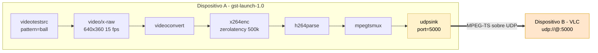
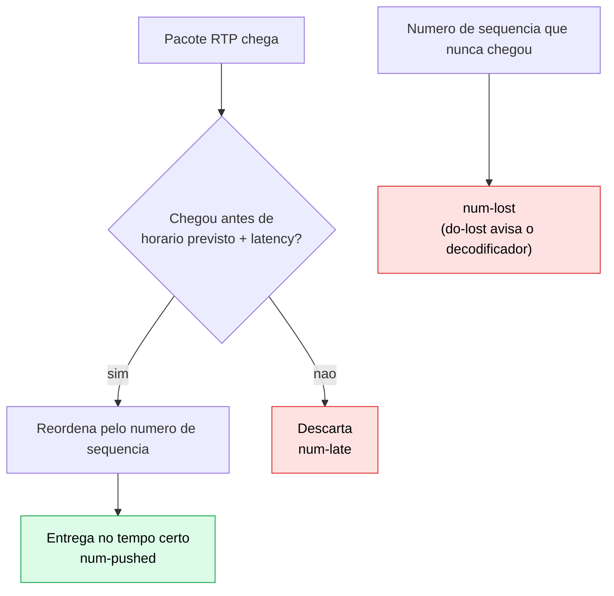

# Diagramas das pipelines

O diagrama da entrega esta em [`diagrama-dispositivos.drawio`](diagrama-dispositivos.drawio). Para abrir, use <https://app.diagrams.net> (Arquivo > Abrir de > Dispositivo) e exporte em PNG se precisar. Abaixo estao os mesmos desenhos em Mermaid.

## Parte 2: audio RTP/UDP entre dois dispositivos

```mermaid
flowchart LR
    subgraph A["Dispositivo A - TRANSMISSOR (192.168.10.1)"]
        direction LR
        SRC["fonte<br/><i>seno / bipe / mic / arquivo</i>"] --> AC1[audioconvert] --> AR1[audioresample]
        AR1 --> CAPS["audio/x-raw<br/>8000 Hz, mono"] --> ENC["mulawenc<br/>PCMU"]
        ENC --> PAY["rtppcmupay<br/>pt=0, 20 ms/pacote"] --> NET["netsim<br/><i>opcional</i>"] --> USINK["udpsink<br/>host=192.168.10.2<br/>port=5004"]
    end

    USINK ==>|"RTP sobre UDP<br/>Wi-Fi / Ethernet"| USRC

    subgraph B["Dispositivo B - RECEPTOR (192.168.10.2)"]
        direction LR
        USRC["udpsrc port=5004<br/>caps RTP PCMU 8000 Hz pt 0"] --> JB["rtpjitterbuffer<br/><b>latency 50 ms ou 500 ms</b><br/>do-lost=true"]
        JB --> DEPAY[rtppcmudepay] --> DEC[mulawdec] --> AC2[audioconvert] --> AR2[audioresample] --> ASINK["autoaudiosink<br/>ou fakesink"]
        JB -. "stats a cada 1 s" .-> CSV["console + CSV"]
    end

    USINK -.->|"mesmo fluxo"| CEL["Celular - VLC<br/>rtp://@:5004"]

    classDef caps fill:#f8cecc,stroke:#b85450,color:#000
    classDef rtp fill:#d5e8d4,stroke:#82b366,color:#000
    classDef udp fill:#fff2cc,stroke:#d6b656,color:#000
    classDef vlc fill:#ffe6cc,stroke:#d79b00,color:#000
    classDef opc fill:#f5f5f5,stroke:#999,stroke-dasharray:4,color:#000
    class CAPS caps
    class PAY,JB,DEPAY rtp
    class USINK,USRC udp
    class CEL vlc
    class NET opc
```

## Parte 1: MPEG-TS sobre UDP ate o VLC

## Decisao do rtpjitterbuffer para cada pacote

